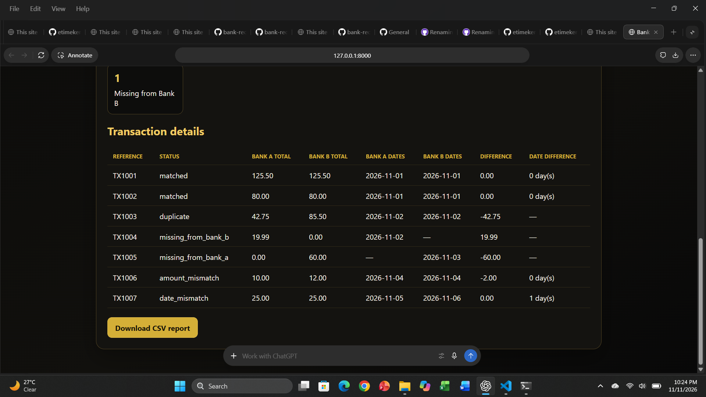

# Bank Reconciliation Demo

A Python learning project that compares two transaction statement CSV files. It includes a command-line tool and a local web page for uploading statements, viewing reconciliation results, and downloading a CSV report.

This is a portfolio prototype that uses synthetic sample data. It is not production banking software. Do not upload real customer, bank, or payment records.

## What it does
- Filters results by reconciliation status.
- Lets users search reconciliation results by transaction reference or status.
- Compares transactions by reference.
- Reports matched entries, duplicates, missing entries, amount mismatches, and date mismatches.
- Supports an optional date tolerance in days.
- Validates CSV columns, amounts, and dates.
- Displays result counts and transaction details in the local web page.
- Downloads the reconciliation report as a CSV file.

## Requirements

- Python 3.15
- PowerShell on Windows

## Install

Open PowerShell in the project folder:

```powershell
cd C:\Users\User\OneDrive\Documents\bank-reconciliation-demo
```

Create a virtual environment if needed:

```powershell
py -3.15 -m venv .venv
```

Install the packages:

```powershell
.\.venv\Scripts\python.exe -m pip install -r requirements.txt
```

## Run the web app locally

Start the web server:

```powershell
.\.venv\Scripts\python.exe -m uvicorn web_app:app --reload
```

Open this address in a browser on the same computer:

```text
http://127.0.0.1:8000
```

Select the two CSV statements, choose a date tolerance, and click **Reconcile statements**. The page displays a summary and transaction details. Click **Download CSV report** to save the report.

Keep the PowerShell window open while using the page. Press **Ctrl+C** in that window to stop the server.

## Run from the command line

Use the synthetic sample statements:

```powershell
py -3.15 .\reconcile.py
```

Choose files and a report path:

```powershell
py -3.15 .\reconcile.py --bank-a .\bank_a.csv --bank-b .\bank_b.csv --output .\reconciliation_report.csv
```

Allow a one-day date difference:

```powershell
py -3.15 .\reconcile.py --date-tolerance-days 1
```

The default date tolerance is zero days, which requires exact date matches.

## CSV format

Each input CSV needs these columns:

```text
reference,amount,date
```

Example:

```text
TX1001,125.50,2026-11-01
```

Dates must use `YYYY-MM-DD`.

## Result statuses

- `matched`: reference, amount, and date match.
- `matched_with_date_tolerance`: reference and amount match, and the dates differ by no more than the selected tolerance.
- `duplicate`: a reference appears more than once in either statement.
- `amount_mismatch`: a reference appears in both statements, but the amounts differ.
- `date_mismatch`: a reference and amount match, but the date difference exceeds the selected tolerance.
- `missing_from_bank_a`: the reference appears only in Bank B.
- `missing_from_bank_b`: the reference appears only in Bank A.

The report’s `difference` value is calculated as Bank A total minus Bank B total.

## Project files

```text
bank-reconciliation-demo/
├── reconcile.py
├── web_app.py
├── requirements.txt
├── bank_a.csv
├── bank_b.csv
└── README.md
```

The sample statements contain synthetic data. The reconciliation report is generated when the program runs.
